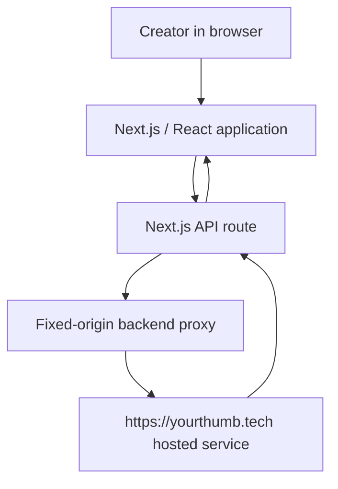

YourThumb — AI-Powered YouTube Thumbnail Studio
Decide first. Render second.

YourThumb is an AI-assisted thumbnail production studio designed to help YouTube creators develop a thumbnail concept before spending time or credits on the final image. Its workflow combines creative direction, a human approval checkpoint, image generation, and post-generation editing tools.
- Live product: https://yourthumb.tech/
- Demo video: https://youtu.be/lsHgdfLbv9U
- Framework: Next.js App Router, React, TypeScript
- Deployment: Vercel (as described for the deployed product)
Repository scope and reproducibility notice

This repository is a sanitized public-source export. It includes the actual frontend and fixed-origin API proxy wrappers, but it does not include all production backend implementations. Several AI ideation, rendering, database, billing, webhook, Canva OAuth, and worker components are redacted or represented by placeholders. Many API requests are forwarded to the hosted service at https://yourthumb.tech.

Consequently, this repository is not a self-contained copy of the production service, and it cannot independently reproduce every workflow described below. Do not treat the presence of this README as evidence that the full backend code or all production workflows are included.

Contents
- The problem
- The solution
- Product workflow
- Technology stack
- Architecture
- Repository structure
- Local development
- Environment variables
- Available scripts
- Security and privacy
- Business model
- Known limitations
- Deployment notes
- Contributing and intellectual property
The problem
Creators compete for attention in crowded feeds, where a thumbnail needs to communicate a video idea quickly. Many smaller channels cannot consistently afford dedicated thumbnail designers. Generic image-generation tools can create an image, but they may not guide the creator through the storytelling, hook, visual hierarchy, and title decisions that make a thumbnail useful.
The solution
YourThumb is designed around concept first, image second. Instead of beginning with an image prompt alone, a creator supplies context and a visual direction. AI-assisted ideation proposes a structured concept for review before the final render is requested. This gives the creator an opportunity to revise the idea or its title before committing to image generation.

The product is intended for small and growing YouTube channels that publish regularly and want a repeatable thumbnail workflow without requiring a full-time designer.
Product workflow
The deployed product presents three ways to begin a thumbnail project:
1. Copycat — use a reference thumbnail as a structural starting point, then adapt the composition to the creator's own video and story.
2. Frame-Based — start with a frame from the creator's video.
3. Asset-Based — start with a blank direction and user-supplied assets.
The general creation flow is:
1. Creative brief: describe the video, audience, intended emotion, and creative angle.
2. Visual direction: select a starting workflow and provide reference material or assets as appropriate.
3. Concept review: review the proposed story, hook, supporting proof, visual plan, and title options where available.
4. Human checkpoint: approve or revise the concept before requesting a final render.
5. Render and review: inspect the generated thumbnail and its status in the application.
6. Refine: use supported editing options, including the Canva connection and text-tweak workflow where available in the hosted product.
Feature scope note: the steps above describe the product experience. The corresponding complete production implementations are not all present in this sanitized repository export. See Known limitations.
Technology stack
Area	Technology	Scope in this repository
Web application	Next.js 16 App Router	Frontend and route structure are included.
UI	React 19, TypeScript	UI components and client-side workflows are included.
Styling and components	Tailwind CSS 4, Base UI, utility-class helpers, Lucide icons	Dependencies and UI code are included.
Authentication client	Supabase JS and @supabase/ssr	Client-side integration is included; production project configuration is external.
AI ideation and image generation	OpenAI-backed capabilities in the hosted product	Provider-side orchestration and critical implementation details are not fully included here.
Data, storage, and realtime updates	Supabase in the described production architecture	The production schema and complete server-side implementation are not included.
Long-running rendering	GitHub Actions worker workflow in the described production architecture	Workflow files in this export are placeholders and do not render images.
Deployment	Vercel for the deployed web application	Deployment configuration is included, but a successful deployment is not guaranteed by this export alone.
Payments	Razorpay and PayPal integrations in the hosted product	This package does not contain complete payment fulfillment or webhook implementations.
Design handoff	Canva integration in the hosted product	The UI and route structure are present; server-side OAuth/export implementations are redacted.

Versions are defined in [`package.json`](./package.json) and locked in [`package-lock.json`](./package-lock.json).
Architecture
Request path available in this export
Most app/api/**/route.ts files use fixed route paths to forward requests to the official hosted YourThumb service. The proxy implementation is in [`lib/backend/live-proxy.ts`](./lib/backend/live-proxy.ts).

The proxy is not a replacement for the backend. It is an integration layer for the hosted service. The public export does not include all of the hosted service's internal logic.
Production workflow described by the product demo
The product demo describes a workflow in which a brief is converted into a structured concept, the creator reviews it, and an approved render is processed by a background worker. It also describes credit/job coordination, storage of the resulting image, live status updates, and recovery/refund behavior for failed jobs.

This is a high-level description of the deployed product's stated design, not a claim that all of those mechanisms can be inspected or run from this repository. In this export, the worker workflows, complete schema, payment fulfillment, and several critical modules are redacted or stubbed.
Repository structure
app/                         Next.js pages, layouts, actions, and API route wrappers
components/                  Application, dashboard, marketing, and UI components
lib/backend/live-proxy.ts    Fixed-origin proxy to the hosted YourThumb backend
lib/                          Shared clients, UI helpers, validation, and integration modules
public/                       Static assets
supabase/                     Supabase configuration and sanitized function/schema placeholders
.github/workflows/            Placeholder render workflow files in this export
docs/HACKATHON_READINESS.md   Repository-scope and readiness assessment
scripts/submission-preflight.mjs
                              Static check for missing/redacted critical implementations
package.json                  Dependencies and development scripts
package-lock.json             Locked npm dependency tree
env.example                   Example public environment configuration
Some files and folders are intentionally placeholders. In particular, do not use the sanitized supabase/schema.sql to initialize a production database.
Local development
Prerequisites
- Node.js 20 or newer
- npm
- A Supabase project configured for the app's authentication flow
- Access to the official hosted YourThumb service for API routes that are proxied to it
Install and run
The repository's environment template is named env.example (without a leading dot):
cp env.example .env.local
npm ci
npm run dev
Open http://localhost:3000.

Configure the Supabase authentication redirect URL for your local development origin (for example, http://localhost:3000/auth/callback) and configure the corresponding Google OAuth settings in the Supabase project.
Important local-development behavior
A local clone of this repository is not an isolated local backend. Requests for supported API workflows are forwarded to https://yourthumb.tech. The proxy forwards the current session cookie and selected headers to the hosted service so it can authenticate requests. Some payment and Canva flows are origin-bound and may redirect to the official website rather than complete on localhost.

Only run a clone you trust. Do not use a third-party-hosted fork with your production account. For the most reliable demo of the hosted product, use https://yourthumb.tech/ directly.
Environment variables
Copy env.example to .env.local and provide the appropriate values:
Variable	Purpose	Notes
NEXT_PUBLIC_SUPABASE_URL	Supabase project URL	Must point to the project configured for the hosted service.
NEXT_PUBLIC_SUPABASE_ANON_KEY	Supabase anon/public client key	Use the appropriate project key; never substitute a service-role key.
NEXT_PUBLIC_APP_URL	Public application origin	Use http://localhost:3000 for local development.
YOURTHUMB_LIVE_BACKEND_URL	Backend proxy destination	Defaults to https://yourthumb.tech; the proxy validates HTTPS and restricts the hostname to yourthumb.tech or its subdomains.

Never put real provider credentials, Supabase service-role keys, payment secrets, Canva client secrets, OpenAI API keys, QStash signing secrets, GitHub tokens, or Telegram bot tokens in this repository or in any NEXT_PUBLIC_* variable. Use protected environment variables or your deployment platform's secret manager for server-only values.
Available scripts
Command	Purpose
npm run dev	Start the Next.js development server.
npm run build	Build the web application.
npm run start	Start the built Next.js app.
npm run lint	Run ESLint.
npm run typecheck	Run the TypeScript compiler without emitting files.
npm run preflight	Scan for required files and critical redactions/placeholders.

Run the main checks with:
npm run lint
npm run typecheck
npm run build
npm run preflight
Expected result for this sanitized export: npm run preflight is expected to fail while the core production implementations remain redacted or proxied. A successful frontend build, by itself, would not verify the hosted backend, payment integrity, authorization, worker behavior, or production readiness. Runtime and end-to-end tests against the complete implementation are not included in this export.
Security and privacy
Security-sensitive systems must be verified in the complete deployed implementation. This repository alone is insufficient for a complete security assessment.
- Keep API keys, signing secrets, service-role keys, payment credentials, OAuth secrets, and user records out of Git.
- Use server-side secret storage for provider credentials; do not expose them through NEXT_PUBLIC_* variables.
- Do not log session cookies, authorization headers, payment data, or private user content.
- Keep API routes restricted to explicit paths and validated upstream hosts; do not turn the proxy into a generic URL proxy.
- Verify authentication, authorization, per-user data isolation, request validation, rate limiting, webhook signatures, idempotency, and credit accounting in the complete backend before production use.
- Review privacy and retention behavior for uploaded images and generated thumbnails before using real user data.
The presence of security headers or validation helpers in the frontend export does not constitute a penetration test or security certification.
Business model
The product demo describes a credit-based model with time-limited credit packs, localized pricing for India and international users, and a referral reward after a referred user purchases a first pack. It also states that the product was pre-revenue and that payment providers were in test mode at the time of recording.

Pricing, AI cost estimates, referral values, and payment status can change. Treat the current product's pricing and checkout UI as the source of truth, and clearly distinguish test transactions from real revenue. The figures described in a demo are not independently verified financial results.
Known limitations
This package is intentionally not a complete production source repository. Among the known limitations are:
- Critical concept-generation and prompt implementations are redacted or stubbed.
- The production render-worker client/types and actual GitHub Actions render/reconciliation jobs are not fully included; the workflow files in this export are placeholders.
- Payment fulfillment and certain PayPal/Razorpay webhook and recovery implementations are unavailable or disabled.
- Canva OAuth and export server implementations are redacted.
- The production Supabase schema and relevant migrations are not included; the schema file in this export is a placeholder.
- Several integration paths depend on the hosted yourthumb.tech service.
- The ZIP export does not include Git history. Use the real repository when linking a project so its genuine history is preserved.
- Dependency installation, build, lint, type-check, and end-to-end behavior should be verified in a network-enabled environment against the intended deployment. No result should be inferred where a check has not been run successfully.
These limitations matter for anyone attempting to self-host the application or evaluate whether the repository independently reproduces the production product. For a competition or audit that requires the entire codebase to be public and locally reproducible, this export does not satisfy that requirement unless the missing implementation is supplied or the organizer explicitly approves an exception.
Deployment notes
The deployed product is hosted at https://yourthumb.tech/. A Vercel deployment of this repository, by itself, creates the frontend/proxy layer and does not restore the private server-side implementations.

Before deploying a self-hosted environment:
1. Confirm that you have permission to deploy and access each required service.
2. Set the public Supabase URL and anon key for the intended project.
3. Configure authentication callback URLs and OAuth settings for the actual deployment domain.
4. Keep all server-only secrets in deployment secrets, not in source control.
5. Confirm which routes call the hosted backend and whether that dependency is appropriate for the deployment.
6. Test authentication, authorization, data isolation, generation, rendering, storage, billing, webhooks, refunds, and recovery paths using approved test accounts.
7. Do not describe the deployment as self-contained until its backend services and scheduled workers are included and tested.
Contributing and intellectual property
This export contains sanitized frontend code alongside redacted proprietary implementation points. Do not attempt to reconstruct or publish private prompts, credentials, production data, internal audit bundles, or proprietary backend logic without authorization.

No open-source license is included in this package. Unless the project owner adds a license specifying otherwise, do not assume the code or assets may be reused, relicensed, or redistributed.
Project summary: YourThumb is an AI-assisted thumbnail studio that emphasizes structured ideation and human approval before rendering. This repository shows its frontend and hosted-backend integration surface; it is not the complete production implementation.